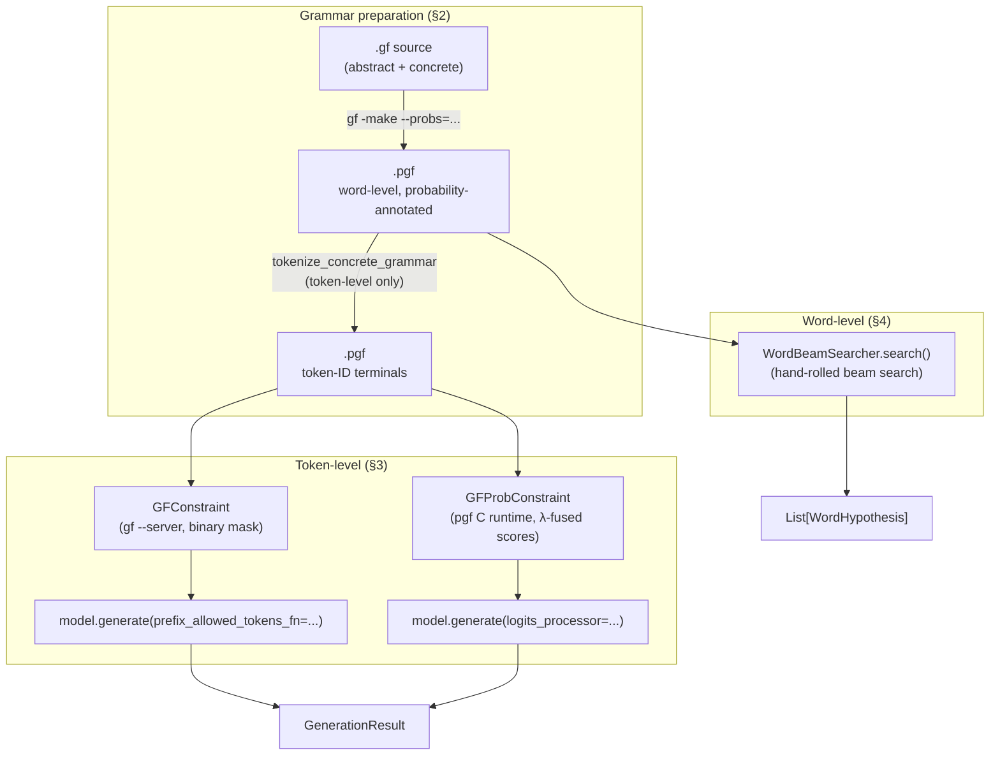
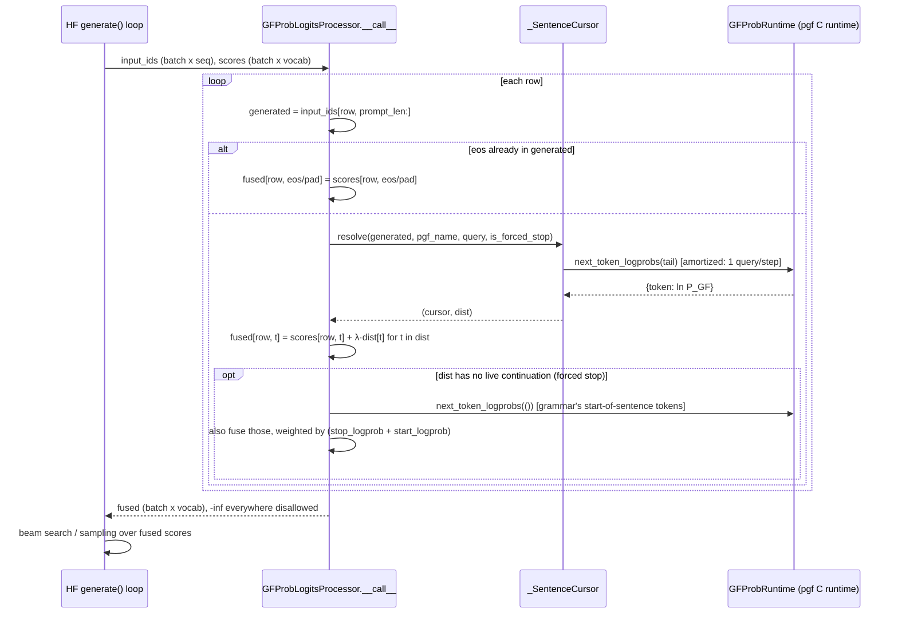
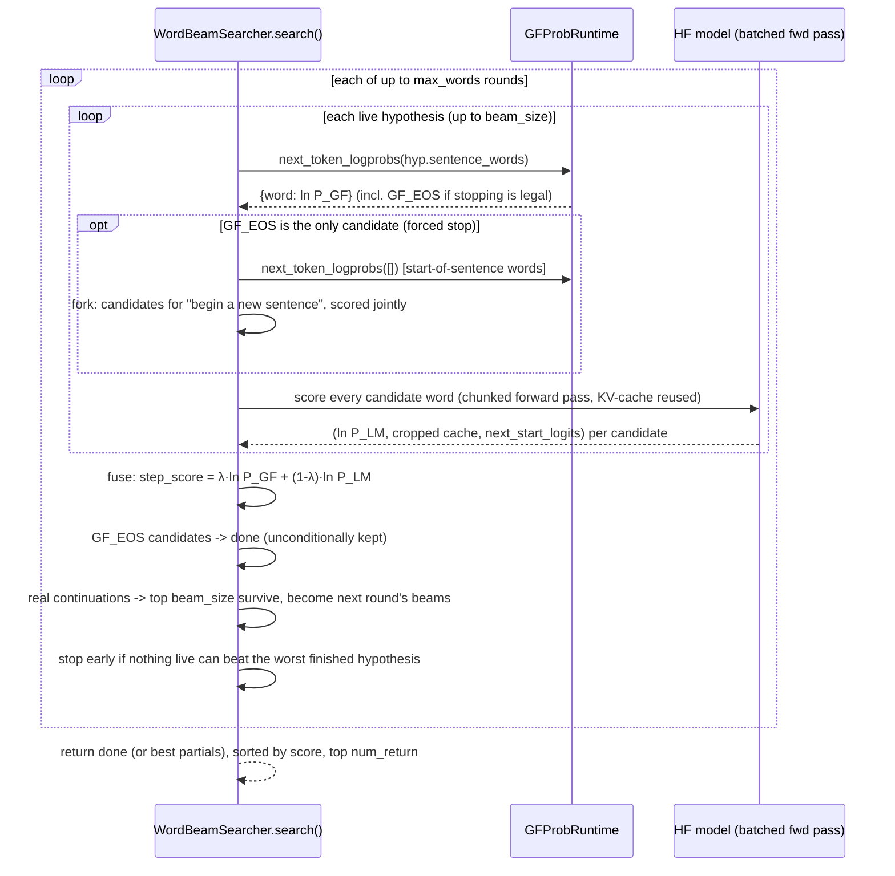

# Pipeline report: grammar-constrained decoding, token-level and word-level

This document is a from-scratch walkthrough of the current `gf_gcd` pipeline —
from a hand-written GF grammar to constrained text out of a HuggingFace causal
LM — for both decoding modes the package supports. It assumes no prior context
beyond general familiarity with GF and HF `transformers`.

Code references are `file.py:line` against the state of the repository at the
time of writing.

## Contents

1. [System overview](#1-system-overview)
2. [Shared grammar pipeline](#2-shared-grammar-pipeline)
3. [Token-level constrained decoding](#3-token-level-constrained-decoding)
4. [Word-level constrained decoding](#4-word-level-constrained-decoding)
5. [The one-sentence-grammar problem and sentence chaining](#5-the-one-sentence-grammar-problem-and-sentence-chaining)
6. [Side-by-side comparison](#6-side-by-side-comparison)
7. [Known limitations](#7-known-limitations)
8. [File map](#8-file-map)

---

## 1. System overview

`gf_gcd` constrains a HuggingFace causal LM's token-by-token decoding so that
its output is always a sentence a hand-written [Grammatical
Framework](https://www.grammaticalframework.org/) (GF) grammar accepts. GF
compiles a grammar to a `.pgf` that can answer, given a prefix, "what tokens
are legal next" — that's the primitive everything else is built from.

There are two independent ways to turn that primitive into a decoding
strategy, and they are the two "modes" this report covers:

- **Token-level**: the grammar's terminals *are* the LM's token IDs. HF's
  native `generate()` loop drives decoding; the grammar plugs in as a mask
  (`GFConstraint`) or a score-fusing `LogitsProcessor`
  (`GFProbConstraint`/`GFProbLogitsProcessor`). One step = one LM token.
- **Word-level**: the grammar's terminals are ordinary words, independent of
  any tokenizer. A hand-rolled beam search (`WordBeamSearcher`) drives
  decoding instead of HF's loop; the grammar proposes legal next *words*, the
  LM scores each as the sum of its subword log-probs. One step = one grammar
  word (which may be several LM tokens).



Both modes share the same grammar-authoring step and the same underlying
completion semantics (`GFRuntime`/`GFProbRuntime`); they diverge only in how
the completion answers get turned into a decoding decision. Both also share
the newest piece of the pipeline: **a compiled grammar only ever accepts one
sentence**, so both modes track where the *current* sentence starts within a
longer run and can chain several grammar-conformant sentences into one
generation — see [§5](#5-the-one-sentence-grammar-problem-and-sentence-chaining).

---

## 2. Shared grammar pipeline

Every mode starts the same way:

| Stage | What happens | Tool |
|---|---|---|
| 0. Author | write `abstract Foo = {...}` / `concrete FooEng of Foo = {...}` by hand, terminals are ordinary words | — |
| 1. Compile | `gf -make`, optionally `--probs=<file>` for a treebank-estimated probability per abstract function | `grammar_tools.compile_grammar` ([tokenize.py:79](../gf_gcd/grammar_tools/tokenize.py#L79)) |
| 2. Tokenize *(token-level only)* | rewrite every string literal `"word"` into `"<id_prefix><tok_id>" ++ ...` for the target tokenizer | `grammar_tools.tokenize_concrete_grammar` ([tokenize.py:52](../gf_gcd/grammar_tools/tokenize.py#L52)) |
| 3. Recompile *(token-level only)* | `gf -make` the rewritten concrete into a token-ID `.pgf`, same probs file | `compile_grammar` again |
| 3b. Chainify *(token-level, as needed)* | restructure functions that emit ≥2 consecutive literal tokens so every function contributes exactly one — works around a C-runtime bug (§7) | `grammar_tools.chainify_and_compile` ([chainify.py:755](../gf_gcd/grammar_tools/chainify.py#L755)) |

Stage 1's output (the word-level `.pgf`) is everything word-level decoding
needs. Stages 2–3 exist purely because token-level decoding needs the
grammar and the LM to share an alphabet: `tokenize_concrete_grammar` is a
textual pass that finds every `"..."` literal in the concrete syntax and
replaces it with the `++`-chain of that string's token IDs under the target
tokenizer (`tokenize.py:52-76`), e.g.

```
lin Wine = "wine" ;
  -->  (with GPT-2's tokenizer, id_prefix="t")
lin Wine = ("t5901") ;      -- " wine" happens to be one GPT-2 token

lin Delicious = "delicious" ;
  -->
lin Delicious = ("t46550" ++ "t935") ;   -- " delicious" is two GPT-2 tokens
```

The non-numeric `id_prefix` (default `"t"`) matters for the probabilistic
backend: the GF C runtime lexes digit-only terminals as `Int` literals, which
breaks its `complete()` query (`tokenize.py:35-46`). `gf --server`'s HTTP
`complete` endpoint (used by the binary `GFConstraint`) is indifferent to it.

Probabilities are attached to *abstract* functions, so one `--probs=` file
(`FunName<TAB>probability`, normalized per result category) works unmodified
for both the word-level and the token-ID rewriting of the same grammar
(`compile_grammar`'s docstring, `tokenize.py:88-92`).

---

## 3. Token-level constrained decoding

### 3.1 Two backends, one interface

Both implement `Constraint` ([constraints.py:80](../gf_gcd/constraints.py#L80)):

```python
class Constraint(ABC):
    def prefix_allowed_tokens_fn(self, prompt_lengths, grammars=None) -> PrefixAllowedTokensFn: ...
    def logits_processor(self, prompt_lengths, grammars=None) -> Optional[LogitsProcessor]: ...
```

`ConstrainedGenerator.generate()` ([generator.py:99-114](../gf_gcd/generator.py#L99-L114))
prefers `logits_processor()` when a constraint provides one (score fusion is
strictly richer than masking) and falls back to `prefix_allowed_tokens_fn()`
otherwise:

```python
processor = constraint.logits_processor(prompt_lengths=prompt_lengths, grammars=grammars)
if processor is not None:
    logits_processor = LogitsProcessorList([processor])
else:
    prefix_allowed_tokens_fn = constraint.prefix_allowed_tokens_fn(...)
```

| | `GFConstraint` | `GFProbConstraint` |
|---|---|---|
| Grammar | any token-ID `.pgf` | must be compiled with `--probs=` |
| Backend | a pool of `gf --server` HTTP processes (`GFServerRuntimeForLM`, [runtime.py:168](../gf_gcd/runtime.py#L168)) | in-process GF C runtime via `pip install pgf` (`GFProbRuntime`, [gf_probs.py:45](../gf_gcd/gf_probs.py#L45)) |
| Decision | binary mask: legal token IDs or not | `fused[t] = scores[t] + λ·ln P_GF(t\|prefix)`, illegal tokens `-inf` |
| `λ=0` | n/a (always pure mask) | reproduces `GFConstraint` exactly (used as its regression test, `test_prob_constraints.py`) |
| HF wiring | `prefix_allowed_tokens_fn` | `logits_processor` (also exposes a `prefix_allowed_tokens_fn` for mask-only compatibility, [constraints.py:489](../gf_gcd/constraints.py#L489)) |

### 3.2 One decoding step

For `GFProbConstraint` (the richer path), `model.generate()` calls
`GFProbLogitsProcessor.__call__(input_ids, scores)` once per step, with one
row per live beam/sample:



`GFConstraint.prefix_allowed_tokens_fn` ([constraints.py:178-217](../gf_gcd/constraints.py#L178-L217))
follows the identical shape, just with a binary allowed-list instead of a
distribution, and `gf --server`'s `complete()` instead of `next_token_logprobs`:

```python
_, allowed = cursor.resolve(generated, pgf, query=lambda tail: query(tail, pgf),
                             is_forced_stop=lambda allowed: not allowed)
if not allowed:                          # no legal continuation left
    allowed = list(query((), pgf))       # + grammar's own start-of-sentence tokens
    if self.eos_token_id is not None:
        allowed = allowed + [self.eos_token_id]
```

### 3.3 `ConstrainedGenerator.generate()`

The user-facing entry point ([generator.py:36](../gf_gcd/generator.py#L36)) is a
thin wrapper: tokenize the prompt(s) with left padding (so `prompt_length` is
the same cut point for every batch element), wire up the constraint, call
`model.generate(**hf_generation_params)`, strip the prompt back off, decode,
and optionally compute per-token log-probs via
`compute_transition_scores(normalize_logits=True)`. Everything about *how*
the constraint decides what's legal is opaque to this layer — it just wires
`prefix_allowed_tokens_fn` or `logits_processor` into stock HF `generate()`
and gets ordinary batching, beam search, sampling, and `num_return_sequences`
for free.

```python
with GFProbConstraint(grammar_dir=..., default_grammar="FoodTok.pgf",
                       eos_token_id=tok.eos_token_id, lambda_gf=0.3) as constraint:
    result = generator.generate(prompt, constraint=constraint,
                                 max_new_tokens=64, num_beams=4)
```

---

## 4. Word-level constrained decoding

### 4.1 Why a separate search loop

Token-level fusion has two structural costs (documented in
[docs/strategy-comparison.md](strategy-comparison.md)): the grammar must be
rewritten per tokenizer, and a multi-token word's grammar probability lands
entirely on its *first* subtoken, which skews beam comparisons mid-word
("the unfair mid-word score problem"). `WordBeamSearcher`
([word_beam.py:108](../gf_gcd/word_beam.py#L108)) avoids both by making the
grammar word the unit of search: the grammar proposes candidate next *words*
with `ln P_GF`; the LM scores each candidate as the sum of its own subword
token log-probs in one batched forward pass; hypotheses grow by
`λ·ln P_GF + (1-λ)·ln P_LM`, and only the top `beam_size` survive each round.

### 4.2 KV-cache reuse

Each surviving `WordHypothesis` ([word_beam.py:55](../gf_gcd/word_beam.py#L55))
carries its own `past_key_values` (a `DynamicCache` for "prompt + words so
far") plus `next_start_logits` (the logits that predict whatever comes right
after it). At each step, per hypothesis (`_score_hyp_candidates`,
[word_beam.py:288](../gf_gcd/word_beam.py#L288)):

1. Only the *candidate words'* own tokens are fed to the model — the shared
   prefix is already baked into the cache, fanned out across all of that
   hypothesis's candidates with `cache.batch_repeat_interleave(m)` rather than
   recomputed.
2. A candidate's first token's log-prob is a lookup into the *previous*
   step's `next_start_logits` — no forward pass needed for it.
3. Once global pruning picks this step's survivors, each one's own row is
   sliced out of the batched result (`_extract_row_cache`,
   [word_beam.py:98](../gf_gcd/word_beam.py#L98)) and becomes its cache for
   next step.

This is what keeps the LM side of the search linear in `max_words` rather
than quadratic (re-encoding "prompt + words so far" from scratch every step,
which an earlier design did — see the module docstring).

### 4.3 One decoding step



### 4.4 Public surface

```python
searcher = WordBeamSearcher(model, tokenizer, runtime, lambda_gf=0.5, beam_size=4)
hyps = searcher.search(prompt, max_words=20, num_return=1)
best = hyps[0]
best.text          # " ".join(best.words) -- the full generated passage
best.finished       # False if max_words was exhausted before a legal stop
best.gf_logprob     # cumulative ln P_GF, separately from...
best.llm_logprob    # ...cumulative ln P_LM
```

Unlike the token-level path, there is no HF `generate()` underneath — no
sampling, no `num_beams` (its own `beam_size` plays that role), no built-in
batching across prompts. What `WordBeamSearcher` buys instead is
tokenizer-independence (the same `.pgf` works for any model) and clean,
word-aligned scores where `GF_EOS` competes against continuations at exactly
the same granularity on both sides of the interpolation.

---

## 5. The one-sentence-grammar problem and sentence chaining

A compiled grammar (e.g. RGL's `Utt`/`Phr`, or the toy `Food`/`Seq` grammars)
accepts **one sentence**. Early versions of this pipeline fed the *entire*
output generated so far to the grammar at every step; that only stays valid
for the first sentence — once the LM produces more than one, the grammar
either force-terminates generation right after the first (its only "no legal
continuation" signal, previously read as "done"), or, in a grammar with
enough internal recursion, gets goaded into stretching one sentence
arbitrarily long to fill the whole token budget instead of ever starting a
second one.

The fix, symmetric across both modes: track where the *current* sentence
starts within the run, query the grammar only against the tail since that
boundary, and — right at a **forced stop** (the current sentence's tail has
no legal continuation left) — also offer the grammar's own start-of-sentence
tokens/words as an alternative to stopping generation outright. A new
sentence can only ever begin exactly there, never as an early exit from a
sentence that could still extend.

### 5.1 Token-level: `_SentenceCursor`

The obstacle is that HF beam search **reorders rows** between decoding steps
— row `i` at step `t` need not be the same hypothesis as row `i` at step
`t+1` — so a cursor keyed by batch/row index would silently track the wrong
hypothesis. `_SentenceCursor` ([constraints.py:19-77](../gf_gcd/constraints.py#L19-L77))
sidesteps that by keying on the **token sequence itself**:

```python
def resolve(self, tokens, pgf_name, query, is_forced_stop):
    key = (pgf_name, tokens)
    if key in self._cache: return self._cache[key]
    if not tokens:
        cursor = 0
    else:
        prev_cursor, prev_result = self.resolve(tokens[:-1], pgf_name, query, is_forced_stop)
        cursor = len(tokens) - 1 if is_forced_stop(prev_result) else prev_cursor
    result = query(tokens[cursor:])
    self._cache[key] = (cursor, result)
    return cursor, result
```

Because `generate()` only ever grows a sequence that was itself handed to
this cursor (one token shorter) at the previous step, `tokens[:-1]` is always
already cached — the recursion is a cache hit down to the one new token, so
this is one grammar query per step, amortized, not O(sequence length).

Worked example (`Seq.pgf`: `"t100 t200"` or `"t100 t300 t400"`, forced-stop
only — no optional mid-sentence exits):

| `tokens` | cursor | why |
|---|---|---|
| `()` | 0 | base case |
| `(100,)` | 0 | `t100` still has legal continuations |
| `(100, 200)` | 0 | complete, but that's *this* call's own result, not yet consulted |
| `(100, 200, 100)` | **2** | previous tail `(100,200)` was a forced stop → new sentence starts at the newest token |
| `(100, 200, 100, 300)` | 2 | `(100,300)` still extendable, cursor unchanged |

`GFConstraint`, `GFProbLogitsProcessor`, and `GFProbConstraint.prefix_allowed_tokens_fn`
all share one `_SentenceCursor` instance per `generate()` call (constructed
fresh each time `prefix_allowed_tokens_fn`/`logits_processor` is built), and
all follow the same shape at a forced stop: fold in `query(())` (the
grammar's start-of-sentence answer) alongside `eos_token_id`.

One deliberate restriction: chaining only ever triggers at a **forced**
stop (dist/allowed has *no* live continuation), never an *optional* one
(`GF_EOS` alongside real continuations, possible only with
`GFProbConstraint`/`GFProbLogitsProcessor`, which know the difference —
`GFConstraint`'s `gf --server` backend has no such notion at all). If a
token were legal both as a mid-sentence continuation *and* as a fresh
sentence start, there would be no way to recover which one a beam meant from
its content alone — so the optional case is left exactly as it always
worked: it competes only with ending generation, not with starting over.

### 5.2 Word-level: `sentence_words`

`WordBeamSearcher` doesn't have the row-reordering problem — each
`WordHypothesis` is an explicit Python object threaded forward via
`dataclasses.replace`, so it can just carry the extra state directly
([word_beam.py:55-69](../gf_gcd/word_beam.py#L55-L69)):

```python
@dataclass
class WordHypothesis:
    words: List[str] = field(default_factory=list)           # every word, all sentences
    sentence_words: List[str] = field(default_factory=list)  # current sentence only
    ...
```

`search()` queries the grammar with `hyp.sentence_words`, not `hyp.words`.
When `GF_EOS` is the *only* candidate (forced stop), it queries a *second*
time with `[]` and adds every word from that as an extra candidate, flagged
`new_sentence=True`, scored as `stop_logprob + start_logprob` (both
components independent grammar queries, so this is exactly the two-step
joint log-probability of "end here, and the next sentence's first word is
X"). A hypothesis therefore forks into two live branches at that step: one
per candidate reaching `GF_EOS` (moved to `done`, exactly as before), one per
`new_sentence` candidate (continues, with `sentence_words = [word]` — a hard
reset — while `words` keeps accumulating).

Because starting a new sentence always pays extra grammar/LM cost relative
to just stopping (P ≤ 1 at every step, so cumulative log-prob is
non-increasing as a hypothesis grows), the single best result of a `search()`
call is unaffected by this — chained hypotheses only show up when nothing
shorter beats them under the budget, or when the caller inspects more than
the top result (`num_return`) — see `test_search_can_chain_multiple_sentences`
in [tests/test_word_beam.py](../tests/test_word_beam.py) for a
demonstration and this data point: with `beam_size=num_return=64`,
`max_words=10`, about half the returned hypotheses for the toy `Food`
grammar are two-sentence chains.

---

## 6. Side-by-side comparison

| | Token-level (`GFConstraint` / `GFProbConstraint`) | Word-level (`WordBeamSearcher`) |
|---|---|---|
| Decoding loop | HF `model.generate()` | hand-rolled in `word_beam.py` |
| Step granularity | one LM subword token | one grammar word |
| Grammar terminals | LM token IDs (recompile per tokenizer) | ordinary words (tokenizer-independent) |
| Legality mechanism | mask (`GFConstraint`) or score fusion (`GFProbConstraint`) | score fusion only |
| Backend | `gf --server` pool, or in-process `pgf` C runtime | in-process `pgf` C runtime |
| Sentence-boundary state | `_SentenceCursor`, content-addressed (survives beam reordering) | `WordHypothesis.sentence_words`, carried directly per hypothesis |
| Chaining trigger | forced stop only (no live continuation) | forced stop only (`GF_EOS` the sole candidate) |
| Sampling / `num_return_sequences` | inherited from HF, free | none — `beam_size`/`num_return` only |
| Batching across prompts | inherited from HF | one prompt per `search()` call |
| Mid-word score skew | present (a word's whole grammar cost lands on its first subtoken) | absent by construction (words scored atomically) |

---

## 7. Known limitations

- **Mid-literal `complete()` bug (C runtime).** `pgf`'s `complete()` errors
  when a prefix ends strictly inside one function's own run of ≥2 literal
  tokens (e.g. mid-way through `Delicious = "t1416" ++ "t563"`). Any grammar
  meant for `GFProbConstraint`/`WordBeamSearcher`'s probability runtime
  should be run through `chainify_and_compile`
  ([chainify.py:755](../gf_gcd/grammar_tools/chainify.py#L755)) first — see
  [docs/chainify.md](chainify.md) and
  [docs/chainify_limitations.md](chainify_limitations.md). `gf --server`
  (used by binary `GFConstraint`) is not affected.
- **`GFConstraint` cannot chain at an *optional* stop.** Its backend has no
  notion of "stopping is legal here but so is continuing" — only "no legal
  continuation left." A grammar with a point where both are genuinely legal
  will, under `GFConstraint`, only ever stop at the forced end; use
  `GFProbConstraint` (even at `λ=0`, pure masking) if optional-stop
  awareness matters.
- **`WordBeamSearcher` has no KV-cache reuse *across* `search()` calls** — if
  you call it repeatedly (e.g. one call per turn of a dialogue), each call
  re-encodes the prompt from scratch.
- **`transformers ≥ 5.0` compatibility.** `word_beam.py` uses
  `DynamicCache.from_legacy_cache`/`.to_legacy_cache`, which transformers 5.x
  removed. Tested and working against `transformers==4.46.3`;
  `pyproject.toml` currently only pins `transformers>=4.40`, so installing a
  5.x release will break `WordBeamSearcher` (not the token-level path, which
  doesn't touch the Cache API at all).
- **Per-sentence chaining budget.** Neither mode has an explicit
  "max sentences" knob — chaining is bounded only by `max_new_tokens`
  (token-level) or `max_words` (word-level), same as the pre-chaining
  behavior.

---

## 8. File map

```
gf_gcd/
├── runtime.py         GFRuntime / GFServerPoolRuntime / GFServerRuntimeForLM
│                       -- gf --server HTTP pool, binary completion queries
├── gf_probs.py         GFProbRuntime, GF_EOS
│                       -- in-process pgf C runtime, next_token_logprobs()
├── constraints.py       Constraint (ABC), _SentenceCursor,
│                       GFConstraint, GFProbLogitsProcessor, GFProbConstraint
│                       -- token-level masking/fusion, §3 and §5.1
├── word_beam.py         WordHypothesis, WordBeamSearcher
│                       -- word-level beam search, §4 and §5.2
├── generator.py         ConstrainedGenerator, GenerationResult
│                       -- HF model/tokenizer wrapper, generate() entry point
└── grammar_tools/
    ├── tokenize.py       tokenize_terminal, tokenize_concrete_grammar,
    │                     ids_to_gf_lin, compile_grammar
    │                     -- §2, stages 1-3
    └── chainify.py       chainify_grammar / chainify_files / chainify_and_compile
                          -- §2 stage 3b, §7 mid-literal workaround

examples/
├── quickstart.py               token-level, toy grammar, GFConstraint
├── quickstart_probs.py         both modes, toy grammar, λ sweep
├── full_pipeline.py            token-level, real RGL grammar, GFProbConstraint
├── full_pipeline_word_level.py word-level, real RGL grammar, WordBeamSearcher
└── rgl_token_level.py          token-level, real RGL grammar, GFProbConstraint

docs/
├── strategy-comparison.md      token-level vs. word-level, deep dive on λ-fusion
├── chainify.md / chainify_limitations.md   mid-literal workaround, usage + edge cases
├── device_setup.md             CUDA/CPU/MPS model loading notes
└── pipeline.md                 this document
```
